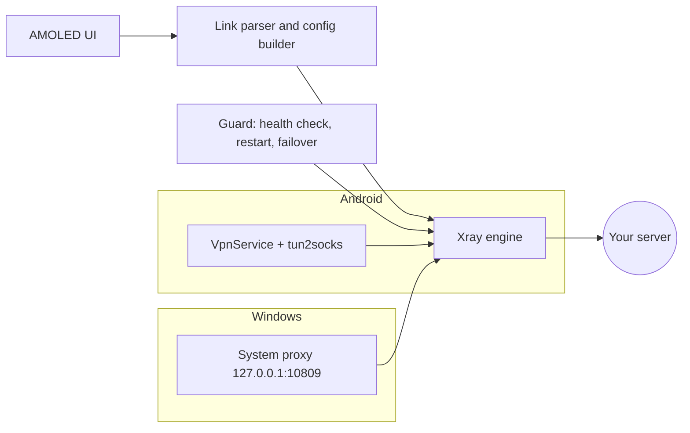

# ÆNET

**A fast, minimal proxy client for Android and Windows. Pure AMOLED black. No ads, no tracking.**

ÆNET connects to your own server or subscription using **VLESS, VMess, Trojan and Shadowsocks** and keeps the
connection alive for you. One big power button, a clear status, and a real explanation when something fails.

> ÆNET is only a client. It does not provide servers. Use it on networks and servers you are allowed to use and
> follow the laws of your country.

## Download

| Platform | File | Needs |
|---|---|---|
| Android | `AENET-<version>-android-arm64.apk` | Android 7.0+ (arm64) |
| Windows installer | `AENET-<version>-windows-setup.exe` | Windows 10 or 11 |
| Windows portable | `AENET-<version>-windows-portable.zip` | Windows 10 or 11 |

Get them from the [latest release](https://github.com/Elmoshy/aenet/releases/latest). Every release has a
`SHA256SUMS.txt` file so you can check the download.

<!-- Add screenshots to docs/screenshots and uncomment:

 

-->

## Features

- **Protocols:** VLESS (Reality, Vision), VMess, Trojan, Shadowsocks. TCP, WebSocket, gRPC, HTTPUpgrade, XHTTP, TLS, Reality
- **Import:** paste links, QR codes (Android), files, subscriptions that refresh by themselves
- **Full editor:** every field in its own box, add servers by hand, edit any time
- **Keeps you online:** health check through the real tunnel, restart, then failover to the next server
- **Tells you why:** certificate expired, server closed the connection, port busy. Not just "failed"
- **Certificate tools:** pin a server certificate, with clear warnings before any relaxed mode
- **TLS fragment** option against filtering
- **Android:** VPN mode, per-app bypass, diagnose screen, speed and time on the main screen
- **Windows:** system proxy mode, installer, engine process closes together with the app (even from Task Manager)
- **Private:** no ads, no analytics, no accounts. Your servers stay on your device

## How it works

The same logic is implemented twice, once per platform: parse a share link into a server, build an Xray config,
run the engine, and watch it. See [`android/`](android) and [`windows/`](windows).

## Build from source

You do not need Android Studio or Visual Studio. GitHub Actions builds everything:

1. Fork the repo and open the **Actions** tab
2. Run **Android** and **Windows** (or push a tag like `v1.0.0` to run **Release**)
3. Download the artifacts

Local builds are described in [`android/README.md`](android/README.md) and [`windows/README.md`](windows/README.md).

## Security notes

- Windows installers and APKs are signed only if the maintainer adds signing secrets. Unsigned Windows files show a
  SmartScreen warning: check the SHA-256 from the release page before running them.
- **Trust any certificate** and auto trust turn off or relax certificate checks for one server. Use them only when you
  understand the risk. **Pin certificate** is the safer option. Details in [SECURITY.md](SECURITY.md).
- Report vulnerabilities privately through GitHub Security Advisories.

## Roadmap

- [ ] Windows: true delay test, full VPN (TUN) mode, tray icon
- [ ] Windows: encrypted storage of servers
- [ ] Android: more ABIs
- [ ] Translations (Arabic UI)

## Contributing

Issues and pull requests are welcome. Read [CONTRIBUTING.md](CONTRIBUTING.md) first.

## License and credits

ÆNET is released under the [MIT License](LICENSE). It builds on Xray-core (MPL-2.0) and other open source projects,
listed in [NOTICE.md](NOTICE.md).
